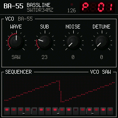
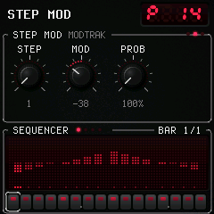
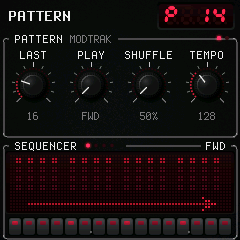

# BA-55

A bassline for the M-VAVE FM-1 by **swtdr34mz**, after the Erica Synths Bassline DB-01. The voice and the sequencer have
only what the DB-01 itself has; on top come three extras on their own buttons: **GROOVE** (HOME twice), and on FX
**12 ready-made effects** (a resonant filterbank after Erica's Resonant Filterbank underneath) and a **reverb**.

On the screen, the look of its panel: matte black, sandblasted aluminium in a soft light from the top left; white
silkscreen with wide letter spacing and hairline white frames with round corners around the sections; black
Moog-style knobs (a finely knurled skirt with a bevel, a flat cap with a soft sheen, a white line) over a printed
scale, their value as red LED dots; the red 7-segment display behind smoked glass, which shows the note that sounds
and, while a knob turns, its value; and the row of 16 rubber step keys whose LEDs glow pink-red and throw light onto
the panel. The curves (the output, the filter, the envelopes, the LFO, the pattern, the mod track, the scale) light up
in an LED dot matrix behind a red diffuser. It opens as the DB-01 does: every segment lit, a running light across the
keys, then **bASS**.

Built on [fm1-base](https://github.com/charlesvestal/fm1-base) and [felucca-bsp](https://github.com/hugelton/felucca-bsp).

   

## The sound

- **VCO**: WAVE (triangle, saw, square), **SUB** (a square an octave down, as from a transistor divider), **NOISE**
  into the filter (with the triangle on a low note and noise fully up: hi-hats, as the DB-01's manual suggests).
- **DETUNE** blends in a copy shifted through a bucket-brigade line. Turned further, its inner LFO runs faster;
  fully up it becomes FM madness.
- **OVERDRIVE** is a blend from the clean sound to the overdrive stage (also on ALGORITHM).
- **FM LVL**: how far the LFO moves the VCO's pitch (far off pitch when high; the LFO reaches audio rate).
- **VCF**: CUTOFF, RESO (fully up it self-oscillates), the envelope's **DECAY** and **DEPTH**, and **MODE** low-pass /
  band-pass. A 12 dB state-variable filter whose two integrators saturate, in the spirit of the Polivoks / Acidbox.
- **VCA**: **RELEASE** of a sustain-release envelope that follows the gate. Fully up the VCA stays open: a drone synth.
- **LFO**: RATE (0.05 Hz to audio rate, or in tempo with SYNC), **LFO LVL** to the cutoff, SHAPE (sine, triangle, saw,
  ramp, square, triple decay saw, saw + triangle, triple ramp, S&H, noise), RESET on every gate.
- **ACCENT** (per step) opens the VCA and the VCF a little. **SLIDE** (per step) glides into the next note, with the
  fixed time of the instrument. **GLIDE** for playing keys and MIDI. **TUNE** 430 to 450 Hz in the settings.

## The sequencer

**64 steps** in four bars of 16. Per step: **NOTE**, **GATE** 10 to 100 % (100 %: tied to the next step, no new
attack; turned fully down the step is off), **ACC/SLD**, **MOD** (an offset to the cutoff), **PITCH ENV** (DEPTH and
DECAY 1 to 9, OFF), **PROB** (100, 75, 50, 25 %, or 1/2, 1/3, 1/4: only every 2nd, 3rd, 4th time round).
For the pattern: **LAST** step, **PLAY** mode (FWD, BWD, RND, PP, PP2: ping-pong with the ends played twice),
**SHUFFLE** and **TEMPO**. The keys transpose a running pattern (C3 plays it as it is).

- **The mod track live**, as on the DB-01: hold **REC** and turn **SELECT** (the cutoff) while the pattern runs; the
  steps take the movement.
- **Notes in**: on a STEP page press REC, then play: each key writes the selected step and moves on; past the last
  step the pattern grows. OCT- / OCT+ on a STEP page move the selected step an octave.
- **RND PATT**: TARGET (PATTERN, NOTES, GATES, ACCENT, SLIDE, MOD, PITCH ENV, PROB, STEP ON), AMOUNT, LOW and HIGH
  (the limits: notes 0 to 24 semitones over the root, gates, mod, pitch envelope depth). **REC** on that page makes
  the new pattern. Notes come from the **SCALE**: chromatic, major, minor, major and minor pentatonic, whole tone,
  major and minor blues, on any **ROOT**.
- **The arpeggiator**: ARP switches it on; held keys play in 16ths, DIR (UP, DOWN, UP&DOWN, RANDOM), OCT 1 to 3,
  GATE 10 to 100 %, LATCH.
- **Copy and paste**: ARP on a STEP page copies the step, and pastes it on the next press.

BA-55 follows **MIDI clock and START / STOP / CONTINUE** over USB; MIDI notes play it (and transpose a running
pattern), pitch bend bends it. Velocity is not used, as on the DB-01: accents come from the pattern.

## Pages

| Button | Page | K1 | K2 | K3 | K4 |
| --- | --- | --- | --- | --- | --- |
| HOME | **VCO** | WAVE | SUB | NOISE | DETUNE |
| HOME again | **GROOVE** | STYLE | KICK | DRUMS | PUMP |
| HOME a third time | **GROOVE SETUP** | RELEASE | HATS | TUNE | VAR |
| FX | **FX** | FX | AMOUNT | MOTION | REVERB |
| SEL | **VCF** | CUTOFF | RESO | MODE | DRIVE |
| ENV | **ENV** | DECAY | DEPTH | RELEASE | GLIDE |
| LFO | **LFO** | RATE | FM LVL | LFO LVL | SHAPE |
| LFO again | **LFO** | SYNC | RESET | | |
| SEQ | **STEP** | STEP | NOTE | GATE | ACC/SLD |
| SEQ again | **STEP MOD** | STEP | MOD | PROB | |
| SEQ a third time | **STEP PITCH ENV** | STEP | DEPTH | DECAY | |
| GLO | **PATTERN** | LAST | PLAY | SHUFFLE | TEMPO |
| GLO again | **SETTINGS** | TUNE | MIDI CH | BEND | |
| EDIT | **RND PATT** | TARGET | AMOUNT | LOW | HIGH |
| EDIT again | **SCALE** | SCALE | ROOT | | |
| ARP | **ARPEGGIATOR** (and the arpeggiator on / off) | DIR | OCT | GATE | LATCH |

## FX: one page, four knobs

Made for playing live: turn one knob and you hear it at once. Only the bassline goes through the FX; the GROOVE
drums come after and stay dry.

- **FX** picks one of 12 effects. Each is a full setting of a ten-band resonant filterbank after the Erica Synths
  Resonant Filterbank (bands at its fixed 29, 61, 115, 218, 411, 777 Hz, 1.5, 2.8, 5.2, 11 kHz), with its own
  resonance, drive, stereo spread, movement and room:
  CLEAN (just the reverb), ACID (a squelch that opens with every note), VOWEL (a talking filter), WAHWALK (a wah in
  tempo), HOWL (resonance that rings on), PHONE (a small speaker), SPACE (dark and wide), COMB (metallic, inverted
  feedback), GHOST (only the airy top), MELT (bands that drift apart), STROBE (bands chopped in tempo), SCREAM (drive
  and resonance all the way).
- **AMOUNT** brings the effect in, and with it more resonance and drive (fully down: off).
- **MOTION** says how fast the effect moves: in Hz for the drifting ones, as a note value (1 bar to 1/32) for the
  ones in tempo, how quickly it falls back for the ones that follow the notes. Fully down: still.
- **REVERB** turns fast (2.5 steps a detent, like SELECT). Up to the middle it is a normal reverb in the effect's
  own room. From the middle on it turns experimental, with every effect: the room grows, the tail becomes almost
  endless, the reverb drifts and shimmers, gets brighter and dirtier and pushes the dry bass back. Fully up it
  hangs on like a frozen pad.

The dot matrix shows the ten bands as faders, with what sounds in each as a bright dot on top (a small spectrum
analyser), and the reverb as a red fog on the right. The title shows which of the 12 is on. The FX settings belong to
each preset; presets saved with v0.1 keep everything and get the FX switched off.

## The battery

Under the name, on every page: a bar that fills steplessly and the charge in percent, read from the cell's voltage
(red below 15 %, blinking below 8 %). On USB power a small lightning bolt.

## GROOVE

The one thing the DB-01 doesn't have, taken over from MONSUN: a beat under the bassline, and the **pumping
sidechain**. Ten styles, two bars each: HOUSE, TECHHOUSE, TECHNO, TRANCE, ACID, DNB, DUBSTEP, GLITCHPOP, EDM, IDM, with
their own kick, clap or snare, hi-hats and percussion, all synthesized here, and their own swing. It runs with PLAY
(and MIDI clock), in the pattern's tempo. Every kick ducks the bassline and lets it swell back; with DRUMS fully down
only the pump stays. The dot matrix shows the five lanes and the pump's curve, the HOME LED flashes with every kick.
HOME twice opens GROOVE, **REC** there switches the groove on and off. The groove settings are global: changing
presets keeps the beat.

## Controls

| Control | What it does |
| --- | --- |
| SELECT | CUTOFF; with REC held while the pattern runs: the mod track |
| ALGORITHM | OVERDRIVE |
| PRESET | The 16 slots (a sound with its pattern) |
| SAVE | Save: PRESET picks the slot, SAVE again saves |
| REC | STEP pages: notes in; RND PATT: a new pattern; GROOVE pages: the groove on / off; elsewhere held 1 s: the slot's factory preset |
| ARP | The arpeggiator on / off, with its page; on STEP pages copy / paste a step |
| OCT- / OCT+ | The keys' octave; on STEP pages the step's octave |
| PLAY | Start / stop |

Presets: BA-55, ACIDLIN, SQRACID, DRONE, BPZAP, DIRTY, ROLLER, SWARM, PSYROLL, BOOMKCK, NOIZHAT, FMGRIT, WOBBLER,
MODTRAK, RANDOM, PROBPAT, each with its pattern. The sound you are working on saves itself once the pattern stops;
the slots only with SAVE.

## The sound core

`dsp/` is plain C with no tie to the FM-1, so the same files can go into a VST3 plugin. To hear it on a computer:

    cc -O2 -Idsp dsp/ba55_core.c tools/render_demo.c -lm -o render_demo && ./render_demo .

`tools/knobcheck.c` turns every parameter from one end to the other and measures what changes.

## Building

    git clone --recursive https://github.com/swtdr34mz-afk/BA-55
    X0X_FONTSET=terminus python3 fm1-base/tools/build.py . --host
    build/host/ba55_host tests/basic.txt build/host

GitHub Actions builds the installable `.fwsc` on every push (Actions tab > the run > Artifacts). A tag `v0.1.0` makes a
release with it.

## Licence

MPL-2.0. See [CREDITS.md](CREDITS.md). Unofficial: BA-55 is not made by or connected with Erica Synths.
