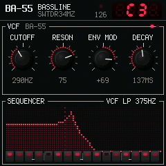
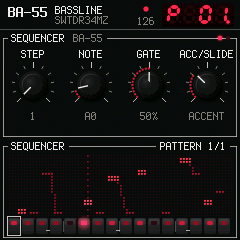
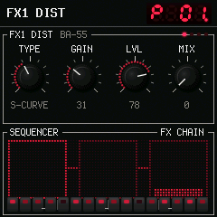

# BA-55

A bassline for the M-VAVE FM-1 by **swtdr34mz**, in the spirit of the Erica Synths Bassline DB-01.
On the screen, the look of its panel: matte black aluminium, white legends and thin white lines around the sections,
black Moog-style knobs over a printed scale, the red 7-segment display (it shows the note that sounds), and the row of
16 step buttons whose LEDs glow pink-red. The curves (the output, the filter, the envelopes, the pattern) light up
in a red LED dot matrix. It opens with the step LEDs running through, as the DB-01 does when it starts.
Built on [fm1-base](https://github.com/charlesvestal/fm1-base) and [felucca-bsp](https://github.com/hugelton/felucca-bsp);
the sound core grew out of [MONSUN](https://github.com/swtdr34mz-afk/MONSUN).

   

## The voice

One **VCO**, switched between TRI, SAW and SQR (the square's width can be modulated), a **SUB** oscillator an octave
down (a square, as from a transistor divider) and **NOISE**. **DETUNE** adds a copy of the VCO that drifts like a
signal through a bucket-brigade delay, up to about 40 cents, and widens the image: from a slight thickening to a swarm.

The filter is a 12 dB **state-variable filter in the spirit of the Polivoks / the Erica Acidbox**: its two integrators
saturate, so at high resonance it tips into a raw, stable whistle instead of blowing up. **MODE** switches between
low-pass and **band-pass**. CUTOFF, RESON, ENV MOD (bipolar) and the filter's DECAY sit together, as on the DB-01.

**DRIVE** (on ALGORITHM) is the one-knob overdrive after the filter: from warmth to tearing, slightly asymmetric.

Three envelopes: the **VCA** and the **filter** as ADSRs (set to decays for the classic sound), and a **PITCH**
envelope (AMOUNT ±36 semitones, DECAY): a short zap, or a kick drum from the triangle.

**ACCENT** works like the 303's: an accented step is louder, its filter opens further with its own short push, and the
resonance bites a little more. **SLIDE** glides into the next step without a new attack (SLIDE time 8 to 400 ms).

If the FM-1 runs short of time (the load over 88 % for a second), BA-55 drops the oversampling by itself and shows
**ECO**.

## The modulators

Three, M1 to M3: each has one source, and its own level to each of 13 destinations at once
(CV, SUB, NOI, PW, CUT, VCA, DRV, DET, FX2, FX3, RES, EGL, HPF). A fast LFO on CV is the DB-01's FM.

| Mode | K2 | K3 | K4 |
| --- | --- | --- | --- |
| LFO | RATE | WAVE: TRI, SQUARE, PULSE 25, TRAPEZ, CHAOS SAW | FADE |
| ENV | A | D/R | S |
| RANDOM | RATE | LAG | PROB |
| STEP | # (1..16 steps) | STEP | ->LVL |

Their second page: **DEST**, **LVL**, **SYNC** (FREE, KEY, BPM, BPM KEY).

## The effects

A 2-pole **high-pass**, then **FX1** (HARD CLIP, FOLDBACK, S-CURVE, TRI CLIP, SHRED, BIT CRUSH), **FX2** (CHORUS,
ENSEMBLE, FLANGER) and **FX3** (DELAY, PING PONG, LARGE REV, SOFT REV), free or in tempo.

## The sequencer

**64 steps**, each with a **NOTE**, a **GATE** (far left REST, far right TIE) and **ACC/SLIDE** (-, ACCENT, SLIDE,
both); for the whole pattern **LENG** (1..64), **DVS** (steps per bar), **PROB** and **SWING**. The bottom of the
screen always shows the 16 step buttons of the page that is playing: a dim LED is a note, a brighter one an accent,
a line to the next button a slide, and the running step glows. While it runs, the keys transpose it (C3 plays it as
it is).

**RECORD**: on a SEQ page press REC, then play: each key writes the selected step and moves on (a hard hit writes an
ACCENT); past the end the pattern grows, up to 64. **ARP** on SEQUENCER copies a step and pastes it on the next
press. **ARP on SEQ SETUP makes a random pattern**, as the DB-01's generator does: notes from a minor pentatonic
around the first step's root, octave jumps, rests, accents and slides over the pattern's length.

BA-55 follows **MIDI clock and START / STOP / CONTINUE** over USB; MIDI notes play it (and transpose a running
pattern), pitch bend bends it.

## Pages

| Button | Page | K1 | K2 | K3 | K4 |
| --- | --- | --- | --- | --- | --- |
| HOME | **VCO** | WAVE | SUB | NOISE | DETUNE |
| SEL | **VCF** | CUTOFF | RESON | ENV MOD | DECAY |
| SEL again | **VCF 2** | MODE (LP / BP) | ACCENT | KEY TRACK | HP CUT |
| ENV | **VCA ENV** (again: **VCF ENV**) | ATTACK | DECAY | SUSTAIN | RELEASE |
| ENV a third time | **PITCH ENV** | AMOUNT | DECAY | TUNE | SLIDE |
| LFO | **M1**, **M1 DEST**, **M2**, **M2 DEST**, **M3**, **M3 DEST** | MODE / DEST | (by mode) / LVL | (by mode) / SYNC | (by mode) |
| EDIT | **SET** | GLIDE | GLIDE MODE | LEGATO | VCA LVL |
| EDIT again | **SET 2** | VEL>CUT | VEL>VCA | HP RES | DRIVE |
| FX | **FX1**, **FX2**, **FX3**, **FX MORE** | TYPE | | | MIX |
| GLO | **GLOBAL** | TEMPO | DLY SYNC | | |
| GLO again | **SETTINGS** | BEND (semitones) | MIDI CH | VELOCITY (on / fixed) | |
| SEQ | **SEQUENCER** | STEP | NOTE | GATE | ACC/SLIDE |
| SEQ again | **SEQ SETUP** | LENG | DVS | PROB | SWING |

## Controls

| Control | What it does |
| --- | --- |
| SELECT | CUTOFF, on every page |
| ALGORITHM | DRIVE |
| PRESET | The 16 preset slots |
| SAVE | Save: PRESET picks the slot, SAVE again saves (any other button cancels) |
| REC held 1 s | The slot's factory preset back (save it to keep it) |
| ARP | HOLD; on SEQUENCER copy / paste a step; on SEQ SETUP a random pattern |
| OCT- / OCT+ | The keys' octave |
| PLAY | The sequencer: start / stop |

Presets: BA-55, ACIDLIN, SQRACID, SUBDROP, BPZAP, DIRTY, ROLLER, DETROIT, SWARM, PSYROLL, BOOMKCK, NOIZHAT, WOBBLER,
FMGRIT, RANDOM, DRONE01. Each comes with its own pattern. The sound you are working on saves itself once the
sequencer stops; the slots only with SAVE.

## The sound core

`dsp/` is plain C with no tie to the FM-1, so the same files can go into a VST3 plugin. To hear it on a computer:

    cc -O2 -Idsp dsp/ba55_core.c tools/render_demo.c -lm -o render_demo && ./render_demo .

`tools/knobcheck.c` turns every parameter from one end to the other and measures what changes.

## Building

    git clone --recursive https://github.com/swtdr34mz-afk/BA-55
    X0X_FONTSET=terminus python3 fm1-base/tools/build.py . --host
    build/host/ba55_host tests/basic.txt build/host

GitHub Actions builds the installable `.fwsc` on every push (Actions tab > the run > Artifacts). A tag `v0.1.0` makes a
release with it.

## Licence

MPL-2.0. See [CREDITS.md](CREDITS.md). Unofficial: BA-55 is not made by or connected with Erica Synths.
